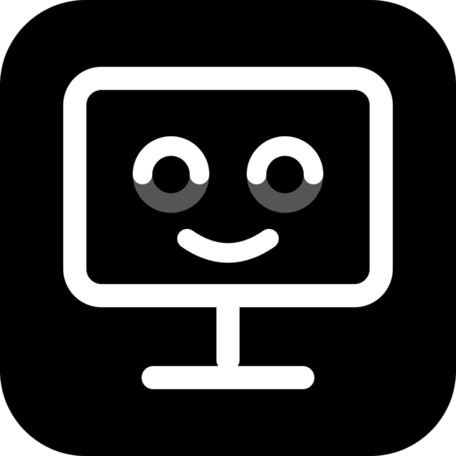

#  Kiosk

An [OpenVoiceOS](https://openvoiceos.org) skill for an assistant that lives
on a screen: a phone on its charger, a tablet on the wall, a Pi in kiosk
mode. By voice:

```
"Go full screen"                 "Fuld skærm"
"Exit full screen"               "Afslut fuld skærm"
"Keep the screen on"             "Hold skærmen tændt"
"Let the screen sleep"           "Lad skærmen sove"
"Install yourself as an app"     "Installer dig som app"
```

Made for [Emkay](https://github.com/emkay-voice/emkay), OpenVoiceOS in the
browser, in all twelve languages it ships (the translations other than
English and Danish are in [`tools/translations.py`](tools/translations.py)).

## How it works

The skill does not touch the screen itself. It asks the screen's client
over the bus, and the client does it and answers:

| request | data | answer on `<type>.response` |
|---|---|---|
| `ovos.kiosk.fullscreen` | `{"enabled": true/false}` | the state below |
| `ovos.kiosk.keep_awake` | `{"enabled": true/false}` | |
| `ovos.kiosk.install` | `{}` | |
| `ovos.kiosk.status` | `{}` | |

```json
{"fullscreen": false, "keep_awake": true, "installed": false,
 "needs_tap": true, "supported": true, "ios": false}
```

A browser allows full screen and installing as an app only after a tap,
not on its own. So the client shows one big button ("Tap for full screen")
and answers `needs_tap`, and the skill says to tap it; `<type>.done`
follows once it is done. When no client answers within three seconds, the
skill says this screen can't do that.

Emkay's page answers these messages. Another GUI client (a kiosk shell, a
Mark II screen) can take the same ones.

## License

Apache-2.0
